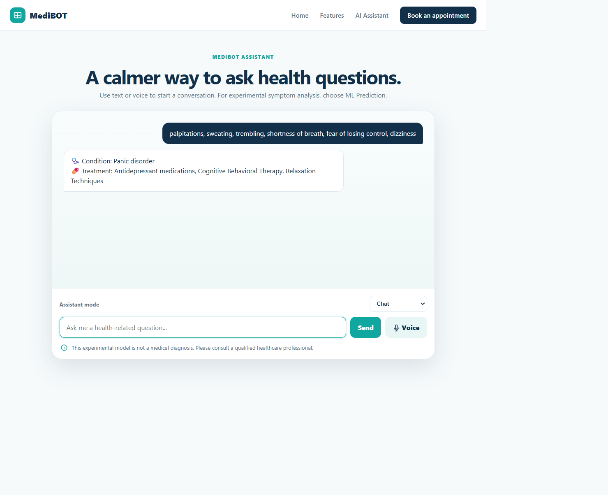
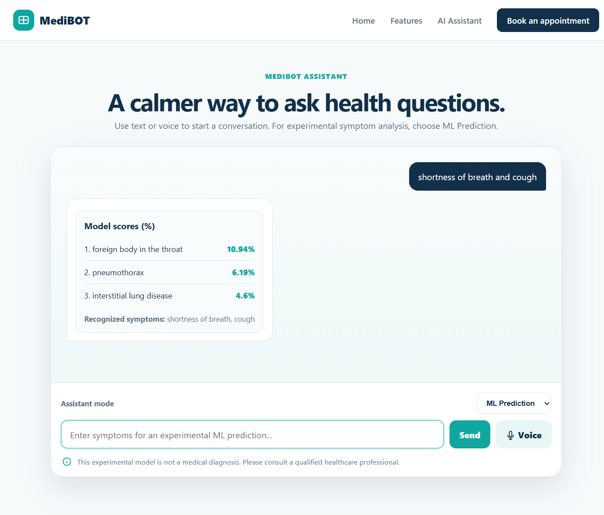
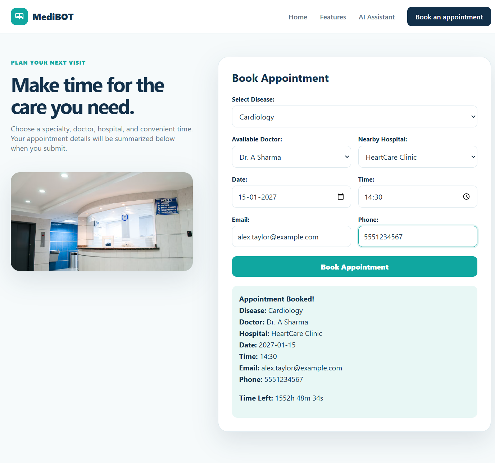
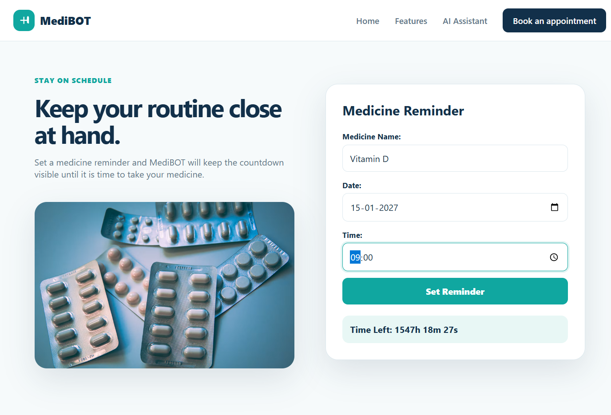

# MediBOT Screenshots and Results

These screenshots were captured from the running MediBOT application using fictional sample inputs. They document the visible interface and actual outputs observed during functional testing.

## Homepage

The homepage presents the MediBOT healthcare technology interface, primary navigation, assistant entry point, appointment access, and medicine reminder features.

## Chatbot response

**Input:** `palpitations, sweating, trembling, shortness of breath, fear of losing control, dizziness`

**Actual output:** The Chat mode returned **Panic disorder** with the treatment information available in the existing medical dataset.

This is the existing symptom-matching chatbot response and is not a medical diagnosis.

## ML predictions

**Input:** `shortness of breath and cough`

**Recognized symptoms:** `shortness of breath`, `cough`

**Actual output:**

1. Foreign body in the throat — 10.94%
2. Pneumothorax — 6.19%
3. Interstitial lung disease — 4.60%

These are experimental **model scores (%)**, not calibrated probabilities, diagnostic confidence, or clinical diagnoses.

## Appointment booking

**Sample input:** Cardiology, Dr. A Sharma, HeartCare Clinic, `2027-01-15 14:30`, `alex.taylor@example.com`, and fictional phone number `5551234567`.

**Actual output:** The interface displayed an appointment summary and countdown. This is a client-side demonstration; no appointment is stored or submitted to a backend.

## Medication reminder

**Sample input:** Vitamin D, `2027-01-15 09:00`.

**Actual output:** The interface displayed a reminder confirmation and countdown. This is a client-side reminder; it does not provide persistent background delivery or server-side storage.
